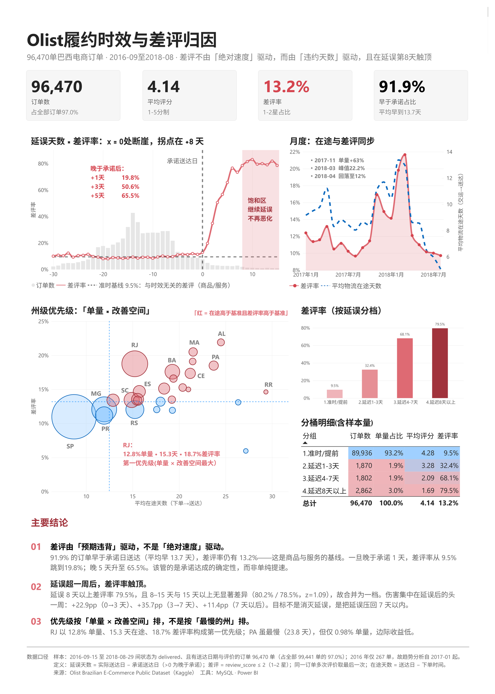

# Olist 电商履约分析

巴西电商平台 Olist 的公开数据，96,470 单已送达订单。

我想搞清楚一件事：差评到底是「送得慢」造成的，还是「没按承诺送到」造成的。

[下载 PDF 高清版](powerbi/olist-dashboard.pdf) ｜ [下载 Power BI 源文件](powerbi/olist-dashboard.pbix)

## 数据

Olist Brazilian E-Commerce Public Dataset（Kaggle），9 张业务表：订单、订单商品、支付、评价、客户、卖家、商品、地理、品类翻译。

原始数据约 120 MB，没有放进仓库。下载地址和导入步骤在 `data/README.md`。

## 分析思路

先把 9 张表导入 MySQL，统一日期字段类型，再逐表检查关联覆盖率。这一步是为了确认哪些表能用 INNER JOIN、哪些必须用 LEFT JOIN。

然后只保留已送达的订单，用「实际送达日 − 承诺送达日」定义延误天数。正数代表晚于承诺，负数代表提前。

## 结论

### 一、差评主要由「没按承诺送到」驱动，不是「送得慢」

91.9% 的订单早于承诺日期送达，平均早 13.7 天，但差评率仍有 13.2%。这部分和时效无关，是商品和服务本身的基线。

一旦晚于承诺，差评率立刻跳起来：晚 1 天 19.8%，晚 3 天 50.6%，晚 5 天 65.5%。

所以真正要管的不是「能不能更快」，而是「承诺的日期能不能达成」。

### 二、延误一周以上，差评率就触顶了

按延误天数分四档：

| 延误天数 | 订单数 | 占比 | 平均评分 | 差评率 |
|---|---:|---:|---:|---:|
| 准时 / 提前 | 89,936 | 93.2% | 4.28 | 9.54% |
| 延迟 1–3 天 | 1,870 | 1.9% | 3.28 | 32.41% |
| 延迟 4–7 天 | 1,802 | 1.9% | 2.09 | 68.09% |
| 延迟 8 天以上 | 2,862 | 3.0% | 1.69 | 79.49% |

从 1–3 天到 4–7 天，差评率涨了 36 个百分点；从 4–7 天到 8 天以上，只涨了 11 个百分点。

我一开始把「8–15 天」和「15 天以上」分成两档，算出来是 80.2% 和 78.5%，差 1.7 个百分点，z 值 1.09，统计上区分不开，就合并成了一档。

结论是：伤害集中在延误后的第一周。目标不是消灭延误，是把延误压回 7 天以内。

### 三、优先级按「单量 × 改善空间」排，不是按「最慢」排

RJ 占 12.8% 的单量，平均在途 15.3 天，差评率 18.7%——单量大、又慢、差评又多，是最该先动的。

PA 虽然最慢（23.8 天），但只占 0.98% 的单量，改它收益有限。

## 运行方式

`sql/` 下 13 个脚本，按编号顺序执行：01 类型转换 → 02/03 校验 → 04–06 去重 → 07/08 建视图 → 09–12 分析 → 13 导出宽表。

跑完把 `v_bi_dashboard_data` 连到 Power BI 就能刷新看板。

## 说明

不是因果推断。这里只描述差异，没有控制品类、价格、卖家这些因素。价格分层做过一次检验，三层的曲线形状基本一致，但也不构成因果识别。

有个异常我没查清。31 天以上的订单差评率反而更低（68.7%，样本 345 单），比 16–30 天的 82.4% 低不少。估计跟远端地区的样本构成有关，但没有验证。

口径：妥投订单指 `order_status = delivered` 且有送达日期；差评指评分 ≤ 2 星；同一订单有多条评价时取最后一次。
